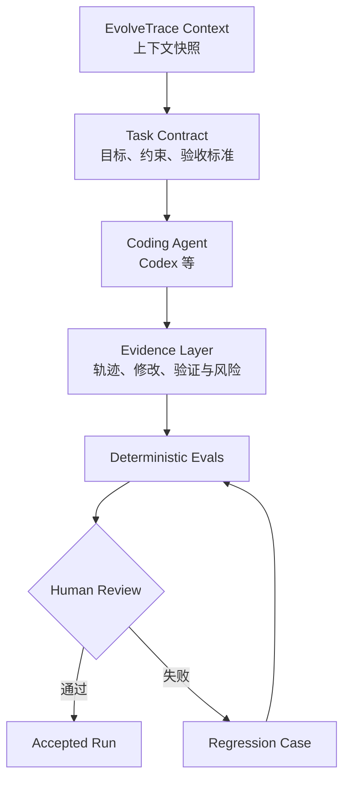

# EvolveTrace

**Local-first command auditing, context, and evidence-based review for coding agents.**

EvolveTrace 在本机记录 Coding Agent 的可观察执行，按项目统计命令类型、次数、结果与耗时，
帮助核对重复读取、反复构建和连续失败，并把 Task、上下文快照、验证证据与人工复核关联起来。
当前为持续开发中的早期版本；通用回归案例导入导出与重放仍在路线图中。

## 上下文与执行证据，共用一个项目

EvolveTrace Context 是本仓库的上下文组件，位于 [`context/`](context/)，继续提供独立的 `aictx` CLI。安装、统一插件、任务绑定与 GitHub 迁移步骤见[合并使用指南](docs/consolidation.md)。

```powershell
python -m pip install ./context
python scripts/build_plugin_archive.py
```

插件归档为 `dist/evolvetrace-plugin.zip`，同时提供上下文加载和执行事件采集。`plugin/` 保留 audit-only 接入。上下文组件保留 MIT 许可证，应用使用 Apache-2.0，详见 [NOTICE](NOTICE)。

源码维护入口统一后，后端仍通过版本化 ContextBundle 接收上下文，独立 CLI 使用方式保持兼容。自动对话提取与语义检索仍需后续设计。

## 项目官网

[打开 EvolveTrace 官网](https://sorenjing-evolvetrace.uas857030604.chatgpt.site) · [下载源码](https://sorenjing-evolvetrace.uas857030604.chatgpt.site/download.html)

官网源码位于 [website/](website/README.md)，包含首页、快速开始、文档、带版本与校验值的源码下载，以及更新记录。官网提供公开介绍和下载，实际审查工具在本机运行。

构建官网：`npm --prefix website ci`，再运行 `npm run site:build`。本地预览：`npm run site:preview`。构建产物 `website/dist/` 可以迁移到其他静态托管平台。

当前版本提供 Codex 执行审查、实时可观测和窄范围的执行前安全保护，并已实现 Task Contract、EvolveTrace Context `ContextBundle v1` 导入、Context Receipt、Run 绑定，以及首个 Evidence-based Evals 纵向切片。它基于 Agent 已公开的事件和验证结果构建证据链，不依赖隐藏思维链，也不上传源代码。

## 为什么需要它

Agent 最终生成的 diff 无法回答完整的工程问题：

- 它接到的需求和验收标准是否明确？
- 它使用的项目上下文是否正确、最新？
- 它执行了哪些命令、申请了哪些权限、修改了哪些文件？
- 它是否真正运行了测试、lint 或 build？
- 高风险操作能否在执行前停止？
- 本次失败能否变成下一次自动复测的案例？

EvolveTrace 的目标不是给 Agent 再套一层聊天界面，而是把需求、上下文、轨迹、评估和人工决策组织成一条可审查的证据链。

## 目标工作流



## 项目边界

| 层 | 职责 |
| --- | --- |
| [EvolveTrace Context](context/) | 维护“AI 应该知道什么”，生成可审计、可追踪 freshness 的项目上下文 |
| Agent Skills | 约束“AI 应该怎样工作”，复用开发行为与流程 |
| EvolveTrace | 记录“AI 做了什么、是否做对、失败如何复现” |

首个完整闭环面向个人多仓库开发，聚焦任务上下文、执行证据、安全检查和回归评估。

学习上下文如何进入这条证据链，可阅读[Context 设计与学习路径](docs/context-design.md)：受控上下文输入、交付证据分级，以及上下文与 Task / Run 的接口衔接。文档包含代码阅读顺序、验证步骤和已有测试入口。

## 当前已实现

- Codex lifecycle Hooks 事件采集
- 本地 SQLite 会话与事件存储
- SSE 实时执行时间线
- 事件流重连及队列溢出后从本地存储恢复历史，按事件 ID 去重
- 输入输出脱敏和 loopback-only API
- 危险命令、权限拒绝、失败调用与修改范围的确定性风险标记
- Safety Sentinel 执行前阻断
- 三栏审查工作台与可复制的修正提示
- Task Contract、Context Snapshot、Context Receipt、活动任务 lease、Run 绑定和 Unbound Runs
- `generated → delivered → acknowledged → evidenced → effective` 的单调证据等级；交付或客户端确认不等于模型理解、遵循或有效
- 任务优先工作台与单进程本地分发
- 结构化 Acceptance Criterion、Context Freshness、Repository Scope 与 Verification 确定性评估
- 不可变 Evaluation Result、人工 Review Decision，以及 `needs_fix → corrected → accepted` 对比闭环
- 合成、脱敏的修复前后回归 fixture；单次成功运行不能自动产生 `effective`
- `start.ps1` 一键启动并支持 Codex 内置 Browser
- 后端测试、前端 lint/build 与 GitHub Actions CI
- Context 项目目录登记、跨项目命令分类统计与重复操作/失败重试线索
- 有界后台执行元数据补齐、延迟记录重试及来源/结果缺口显示
- 可选分析窗口、忽略/静音设置、带证据的人工确认审计记忆及按项目回读

跨项目统计、分析和后续记忆加载见[跨项目审计使用指南](docs/workspace-audit.md)。

命令频次是工作流线索，不是真实磁盘 I/O 或硬件健康指标，不能用于诊断磁盘损坏。
“选择分析”打开本地分析窗口并准备可复制提示，用户自行发送给 Codex。

## 快速开始

完成一次性依赖安装后，在仓库根目录运行：

```powershell
./start.ps1
```

在 ChatGPT 桌面版 Codex 中希望使用内置 Browser：

```powershell
./start.ps1 -NoBrowser
```

然后让 Codex 打开 `http://127.0.0.1:8001`。首次使用先运行 `./scripts/build_static_ui.ps1`；完整环境配置、日常使用和观测排障分别见 [RUN.md](RUN.md)、[中文使用手册](docs/usage.md) 与 [观测手册](docs/observability.md)。

## 效果验证

采集覆盖、风险规则和人工审查收益的指标及对照步骤见[效果验证指南](docs/effectiveness.md)。服务健康和事件数量不等于审查效果。

## Safety Sentinel 边界

第一版只对 Codex `PreToolUse` 暴露的 Bash 命令做确定性判断，并阻断四类高置信度操作：

- 格式化或擦除存储设备
- 直接向物理磁盘写入
- 递归删除文件系统根目录、家目录或父目录
- 将网络下载内容直接管道给 shell 执行

普通项目清理和 Git 恢复命令仍会记录并标记风险，但不会自动阻断。Hook 覆盖并不完整，因此 Safety Sentinel 是 Guardrail，而不是完整沙箱。

## 下一阶段

- **M0.4 后续 Evaluators**：Safety、event absence、文件存在性编排与更完整的验收证据覆盖
- **M0.5 Regression Harness**：失败分类、脱敏案例导入导出与通用重放集合
- **M0.6 LLM Judge Experiments**：可选 Judge、rubric/version、gold labels 和偏差评估

详细设计见 [DESIGN.md](DESIGN.md)，首个里程碑实施计划见 [Task & Context implementation plan](docs/superpowers/plans/2026-09-09-task-context-milestone.md)。

## 数据与隐私

安全报告与支持边界见 [安全政策](SECURITY.md)，依赖告警检查见[依赖安全说明](docs/dependency-security.md)。

- 默认只监听 `127.0.0.1`
- 原始 Hook payload 不落盘
- 常见 API Key、Token、Cookie、JWT 和 URL 凭据会脱敏
- 不上传源代码，不依赖云账号
- Context Snapshot 和 Regression Case 默认只保存在本地
- 公开 fixtures 只能使用合成数据，不得包含真实 `.ai/` 内容、公司信息、私人仓库内容或本机绝对路径

## 开发与验证

在个人电脑上执行：

```powershell
cd backend
venv\Scripts\python.exe -m pip install -r requirements-dev.txt
venv\Scripts\python.exe -m pytest -q
cd ..
npm run lint
npm run build
```

## License

应用采用 [Apache License 2.0](LICENSE)，`context/` 组件保留 [MIT](context/LICENSE)，来源与许可范围见 [NOTICE](NOTICE)。第三方依赖遵循各自许可证。若项目对你的业务有帮助，欢迎自愿支持后续开发；赞助不是使用条件。
