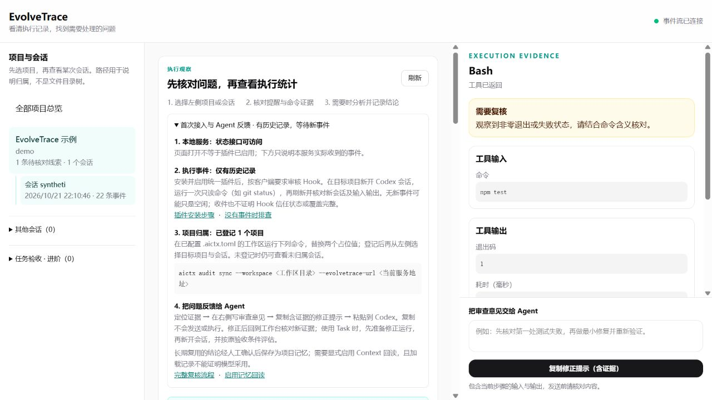
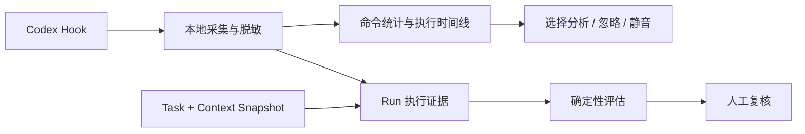

# EvolveTrace

**看清 Coding Agent 执行了什么，再决定下一步。**

Local-first command auditing and evidence-based review for coding agents.

[](https://github.com/sorenjing/EvolveTrace/actions/workflows/ci.yml)
[](LICENSE)

Agent 为什么反复读取同一批文件？测试是真的通过了，还是根本没有拿到结果？
EvolveTrace 收集 Codex 公开的 Hook 事件，在本机按项目整理命令类型、次数、结果与耗时，
把重复操作、连续失败和风险提示关联到具体执行证据，供你选择分析、忽略或静音。

需要审查任务结果时，还可以绑定项目上下文、验收条件和 Run，运行确定性评估并记录人工复核。
执行记录保存在本地 SQLite，不需要模型账号或 API Key。

[快速开始](#快速开始) · [合成数据演示](docs/demo.md) · [使用手册](docs/usage.md) · [项目官网](https://sorenjing-evolvetrace.uas857030604.chatgpt.site) · [参与贡献](CONTRIBUTING.md)

> **早期版本**：命令审计、任务复核、修正尝试准备和前后 Run 比较已接入工作台。支持本地 Run 回归草稿导出、人工冻结和离线证据重新评分；执行修正仍需在目标仓库新开 Codex 会话，Agent 重新执行与独立结果验收仍在开发计划中。



*实际工作台中的合成调用示例：区分历史记录与当前收件，右侧可复制带证据的修正提示。示例命令未实际执行，耗时为合成值；另有可本地运行的[最小任务演示](docs/demo.md)。*

## 可以用它做什么

| 你遇到的问题 | 当前提供的帮助 |
| --- | --- |
| Agent 来回搜索、反复构建，难以判断卡在哪里 | 按项目查看命令分类、次数、结果和耗时，从重复操作或失败提醒回到原始事件 |
| 想分析异常，又不希望每次提醒都打断工作 | 选择打开本地分析窗口，复制带证据的提示给 Codex；也可忽略或静音 |
| 已看懂问题，希望 Agent 根据证据修正 | 在右侧填写审查意见，复制包含配对输入输出的修正提示，粘贴到 Codex；修正后再核对新证据 |
| Agent 声称“已完成”，需要核对验证依据 | 将 Task、Context Snapshot 与 Run 关联，检查上下文 freshness、仓库范围和验证证据，保存人工复核 |
| 多个项目反复遇到相似问题 | 人工确认审计记忆，再由 Context 按项目回读 |
| 担心明显危险的 shell 操作 | 在支持的执行前 Hook 中，用窄范围规则拒绝高置信度危险命令 |

例如，连续失败提醒可以帮助你发现某条测试命令正在反复失败。
你可以检查事件中的结构化结果，再决定补充依赖、修正命令或继续排查。
次数本身不说明失败原因；没有退出结果的调用会保留为未知。

## 快速开始

以下以 **Windows / PowerShell** 为例，需要 Python **3.11+**、Node.js **22+**。
首次安装需要联网下载依赖。Context CLI 另有 Windows、macOS、Linux CI；完整工作台的首选上手路径是本机 PowerShell。

```powershell
git clone https://github.com/sorenjing/EvolveTrace.git
cd EvolveTrace

# 准备后端依赖
python -m venv backend/venv
./backend/venv/Scripts/python.exe -m pip install -r backend/requirements-dev.txt

# 安装前端依赖并构建静态工作台
./scripts/build_static_ui.ps1

# 启动本地服务与浏览器
./start.ps1
```

打开 `http://127.0.0.1:8001`。使用 Codex 内置 Browser 时，运行 `./start.ps1 -NoBrowser`，再打开同一地址。

**刚启动时没有执行记录是正常的。** 接下来选择一条路径：

- **先看看界面**：使用[隔离的合成数据演示](docs/demo.md)，无需接入真实项目。
- **记录自己的执行**：构建并安装统一插件，按[安装与启用步骤](docs/consolidation.md)完成客户端配置后，运行一次 Codex 任务。

```powershell
# 在仓库根目录构建插件归档
./backend/venv/Scripts/python.exe scripts/build_plugin_archive.py
```

归档输出为 `dist/evolvetrace-plugin.zip`。生成 ZIP 还不等于客户端已安装或启用插件；
接入后可用[观测手册](docs/observability.md)逐层确认服务、Hook 和事件是否正常。
后台常驻、前后端开发与实验性 Docker 配置见 [RUN.md](RUN.md)。

## 从命令记录到任务复核



| 能力 | 当前入口与边界 |
| --- | --- |
| 项目命令统计、重复操作与连续失败提醒 | 工作台先展示待核对线索并定位证据，再按操作目的查看次数、结果与耗时覆盖；正常查询非零结果单列 |
| 实时执行时间线、风险检查、分析提示 | 工作台；SSE 重连后恢复已入库历史，按事件 ID 去重 |
| Task、Context Snapshot、活动任务绑定 | Context CLI / HTTP API；工作台查看任务、上下文与 Run，目前没有完整的创建表单 |
| 确定性评估与人工复核 | 工作台 / API；覆盖上下文 freshness、仓库范围和验证证据，未接入的必需验收条件会阻止接受 |
| 修正与前后 Run 比较 | 工作台 / API；需修复后准备新尝试，在新 Codex 会话执行，再评估、人工接受并逐项对比；有效性确认仍受后端回执门禁约束 |
| 经人工确认的审计记忆 | 分析窗口确认，支持适用条件、到期、替代与撤销；Context 按项目回读仍有效记录，工作台保留历史与已上报的加载记录 |
| 离线证据回归 | [CLI 与案例格式](docs/regression.md)；本地 Run 导出草稿、人工冻结、重新评分，保留差异和未知，不执行记录中的命令 |
| 通用回归案例、LLM Judge、系统资源采样 | 计划中 |

详细流程见[跨项目审计与记忆](docs/workspace-audit.md)和[上下文证据演示](docs/context-evidence-demo.md)。
指标与对照步骤见[效果验证指南](docs/effectiveness.md)；目前没有足够实测数据宣称减少了多少时间、Token 或磁盘写入。

## 项目上下文：EvolveTrace Context

[`context/`](context/) 提供可独立安装的 `aictx` CLI，用于维护跨项目上下文、跟踪 freshness、准备任务并交付版本化 ContextBundle。
后端通过 JSON 契约接收上下文，不要求 Agent 使用同一种工作流。

```powershell
./backend/venv/Scripts/python.exe -m pip install ./context

# 在配置了 .aictx.toml 的工作区登记项目目录
./backend/venv/Scripts/aictx.exe audit sync --workspace <工作区目录> --evolvetrace-url http://127.0.0.1:8001
```

初始化工作区、任务交付与旧版本迁移见[合并使用指南](docs/consolidation.md)，
设计与代码阅读路径见[Context 设计](docs/context-design.md)。
交付或客户端确认只证明上下文到达了某个环节，不能证明模型理解、遵循或从中获益。

## 采集、安全与隐私边界

- 命令频次反映工作流线索，**不测量真实磁盘 I/O，也不能诊断磁盘损坏**。
- “选择分析”打开本地窗口并准备可复制提示，由用户自行发送给 Codex；尚未接入 Codex 原生分析弹窗。
- 服务默认只监听 `127.0.0.1`。原始 Hook payload 不落盘，但规范化事件仍可能包含命令、代码片段或输出；常见凭据会按模式脱敏，不能保证清除所有敏感内容。
- 执行记录默认留在本机，应用没有自动上传源代码的流程；主动复制分析提示、提交 Issue 或配置 Context 发布前仍需检查内容。
- Hook 覆盖取决于客户端提供的事件。普通采集失败会形成证据缺口；缺失事件不能证明动作没有发生。
- Safety Sentinel 只在支持的 `PreToolUse` Bash 事件上，拒绝格式化/擦除设备、直接写物理磁盘、递归删除根目录/家目录/父目录、下载内容管道给 shell 等高置信度危险操作。它不是完整沙箱。

详见 [Hook 事件契约](docs/hook-event-contract.md)、[安全政策](SECURITY.md)和[依赖安全说明](docs/dependency-security.md)。
公开复现请使用合成数据，不上传真实会话、数据库或工作区截图。

## 接下来与参与贡献

接下来优先用真实任务验证“发现问题 → 记录处理 → 新 Run → 同一组条件复核”的操作路径，
再扩展更多评估器和通用回归案例。可选 LLM Judge、系统资源采集需要单独设计与验证。
架构见 [DESIGN.md](DESIGN.md)，变更见 [CHANGELOG.md](CHANGELOG.md)。

适合参与的方向包括：

- 客户端 Hook 兼容性：提供客户端版本、复现步骤与合成事件。
- 命令分类和风险规则：同时提供命中与不应命中的样例，避免把正常工作误判为异常。
- 首次安装体验：指出卡在哪一步，以及预期看到什么。
- 确定性评估：补充可追溯证据和失败用例。

请先阅读[贡献指南](CONTRIBUTING.md)。本地验证：

```powershell
cd backend
./venv/Scripts/python.exe -m pytest -q
cd ..
npm test
npm run lint
npm run build
```

官网源码与发布说明见 [website/](website/README.md)。官网构建要求干净提交，以便文档与源码下载对应同一版本。

## License

应用采用 [Apache License 2.0](LICENSE)，`context/` 组件保留 [MIT](context/LICENSE)。来源与许可范围见 [NOTICE](NOTICE)，第三方依赖遵循各自许可证。
