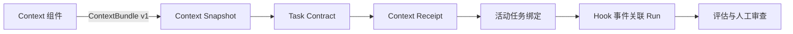

# EvolveTrace Context：设计与学习路径

EvolveTrace 的证据链从任务输入开始：先确定项目背景和验收条件，再观察执行，最后评估结果。`context/` 是这条链路的上下文输入组件；执行采集、评估与审查由 `plugin/` 和 `backend/` 等模块承担。安装步骤见[合并使用指南](consolidation.md)。

本文按三个问题讲解已有实现：上下文怎样进入 Agent、怎样证明交付、怎样与任务和运行连接。它们属于同一产品的不同职责，不需要安装另一个独立产品来学习。

## 1. 上下文如何受控地进入 Agent

典型场景是切换到一个已有项目开始任务。输入来自工作区文件，加载器先定位工作区、选择项目，再读取有限的背景材料。

### 阅读顺序

1. [`config.py`](../context/src/ai_context_kit/config.py)：工作区定位与配置。
2. [`context_delivery.py`](../context/src/ai_context_kit/context_delivery.py)：`prepare_context`、`_safe_path`、`_read` 和 `session_start`。
3. [`facts.py`](../context/src/ai_context_kit/facts.py) 与 [`state.py`](../context/src/ai_context_kit/state.py)：限定范围的元数据观察和 freshness 判定。
4. [`session_start.py`](../context/hooks/session_start.py) 与 [`hooks.json`](../hooks/hooks.json)：宿主 Hook 如何调用加载器。

### 已有机制

- 只加载 `.ai/GLOBAL.md`、`.ai/WORKSPACE.md` 和选定项目的 `.ai/projects/<project>.md`。
- 从当前目录选择项目时优先匹配最深的项目路径；在工作区根目录或存在歧义时给出提示，避免随意加载其他项目。
- 拒绝链接路径和工作区外路径。单文件最多读取 8 KiB，配置可以进一步收紧；文件正文合计最多 16 KiB。
- 缺失文件、空语义记忆、超限、过期或未知状态会成为显式 findings；加载不会自动改写语义记忆。
- 输出携带项目、状态、来源与 freshness 提示。freshness 只覆盖规定的元数据，不能保证每个业务事实或全部源码都最新。

这里值得学习的是输入边界：项目选择、读取预算、路径验证和失败可见性。当前机制读取预先维护的记忆文件；它不负责自动筛选长对话中的重要内容，也不是语义检索系统。

## 2. 如何证明交付，而不是只看到“调用成功”

需要区分两个记录体系：本地加载记录回答“输出了哪些来源”，Harness 回执回答“这些上下文与哪一个任务、快照和运行相关”。

| 记录 | 状态或字段 | 可以说明什么 |
| --- | --- | --- |
| 本地 `.ai/usage.json` | `returned`、`partial`、`blocked`，来源字节数及 SHA-256 | 加载器的输出与缺口；不是宿主接收确认 |
| Harness `ContextReceipt` | `generated → delivered → acknowledged → evidenced → effective` | 按契约逐级积累的交付、确认、运行和效果证据 |

`emit_context` 在输出后记录本地元数据；日志不保存上下文正文，最多保留 20 条事件，`model_use` 保持未知。`returned` 与 Harness 的 `delivered` 不是同一种状态，不能互相直接替代。

Harness 回执按级别前进，不能跳级或倒退。加载器输出、HTTP 接收、客户端确认、可观察执行和效果验证是不同证据：单次运行成功不能自动变成 `effective`，模型理解或遵循也不能从一条输出日志推断。

### 阅读顺序

1. [`context_delivery.py`](../context/src/ai_context_kit/context_delivery.py)：`emit_context`、`_record` 和 `read_usage`。
2. [`task_contracts.py`](../context/src/ai_context_kit/task_contracts.py)：客户端回执结构与状态推进。
3. [`models.py`](../backend/harness/models.py) 与 [`harness_service.py`](../backend/services/harness_service.py)：后端验证、运行绑定及证据流转。
4. [上下文证据演示](context-evidence-demo.md)和[效果验证指南](effectiveness.md)：如何观察与验证结果。

学习重点是把“运行了”“接收了”“有效了”拆开。这种证据设计可用于其他 Agent 工具，避免把安装成功、请求数量或日志数量当成效果指标。

## 3. 上下文如何与任务、运行可靠连接

同仓库维护不意味着后端直接调用上下文组件的 Python 内部实现。组件通过版本化 JSON 接口提交数据，后端负责验证、存储和运行关联。



[`evolvetrace_client.py`](../context/src/ai_context_kit/evolvetrace_client.py) 的 `submit_task` 依次提交快照、创建任务、提交交付回执，再激活任务绑定，并检查服务返回的标识是否匹配。自动 SessionStart 加载不会代替这一任务提交流程；只有会话事件而没有任务绑定时，工作台可以显示未绑定会话。

客户端限定 loopback 地址并设置请求超时。网络不可用或服务端错误会返回未完成结果和告警；4xx 契约错误需要纠正。多个请求之间可能已有部分提交，不能将客户端未完成理解成服务端没有任何记录，也不能凭空补造交付证据。

### 阅读顺序

1. [`harness_export.py`](../context/src/ai_context_kit/harness_export.py)：构建可移植的 ContextBundle。
2. [`evolvetrace_client.py`](../context/src/ai_context_kit/evolvetrace_client.py)：请求顺序、标识校验与失败处理。
3. [`context_bundle.py`](../backend/harness/context_bundle.py)：版本、字段、大小与绝对路径等边界验证。
4. [`routes.py`](../backend/api/routes.py)、[`harness_service.py`](../backend/services/harness_service.py) 与 [`audit_service.py`](../backend/services/audit_service.py)：从 HTTP 接收进入任务和运行证据链。

学习重点是稳定契约和职责分离：Context 生成输入，Harness 消费输入并关联执行。只审查工具事件时可以使用 audit-only 接入；独立 CLI 也可以在后端未运行时加载本地上下文。

## 如何自行验证

将下面的 `<项目名>` 和 `<工作区根目录>` 替换为实际值。先按[安装指南](consolidation.md)准备 CLI。

```powershell
aictx status --workspace <工作区根目录>
aictx load <项目名> --workspace <工作区根目录>
aictx usage <项目名> --workspace <工作区根目录>
```

`load` 会输出上下文并写入有界的本地加载记录。检查项目是否正确、来源是否仅为预期文件、是否有 findings，以及 `usage` 中是否出现对应时间的记录。自动加载还需要宿主实际触发 SessionStart，并审核、启用当前 Hook；详见[观测手册](observability.md)。

在准备任务、提交任务并运行一次真实 Agent 任务后，检查工作台中的 Task、Context Snapshot、Receipt 和 Run 是否对应。事件采集与完整任务绑定分别验证，避免拿历史会话证明本次接入成功。

已有测试适合用来学习失败分支，无需修改真实工作区制造错误：

| 测试文件 | 重点 |
| --- | --- |
| [`test_context_delivery.py`](../context/tests/test_context_delivery.py) | 项目选择、读取范围、过期和缺失提示、链接拒绝、记录上限 |
| [`test_evolvetrace_client.py`](../context/tests/test_evolvetrace_client.py) | 结构化契约与提交顺序 |
| [`test_context_receipts.py`](../backend/tests/test_context_receipts.py) | 回执幂等、状态推进、字段限制、快照匹配 |
| [`test_task_context_replay.py`](../backend/tests/test_task_context_replay.py) | 任务、上下文与运行证据的关联 |

## 如何判断这部分是否值得保留

技术检查证明实现满足契约；产品验证需要真实任务对照。对同类任务记录开启与关闭 Context 时的错误项目背景、旧事实引用、重复分析和人工纠正次数，并同时记录任务成功率及维护记忆的成本。控制模型、任务难度和可用工具，重复观察后再判断。

若只增加交付日志，却没有减少错误或纠正成本，就应缩减加载范围、调整记忆维护方式，或停用这一可选组件。实现已被调用，不等于已证明收益。
